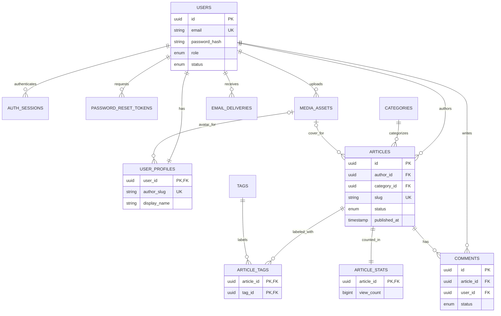

# Bachina Labs Academy — Database Architecture

> **Update note (13 October 2026):** This is the detailed technical **baseline** created before the additional MCP and subscription-entitlement decisions. Its original exclusions of MCP/subscriptions have been superseded **only to the extent specified in `PRODUCT_REQUIREMENTS.md`, `SYSTEM_ARCHITECTURE.md`, `MCP_ARCHITECTURE.md`, and `PROJECT_MEMORY.md`**. Do not implement the starter Prisma schema unmodified: extend/review it for entitlements and MCP grants before migrations. Pricing/online billing remains undecided.


**Version:** 1.0 (proposed logical/physical design)  
**Prepared by:** Skyra Tech  
**Scope:** Bachina Labs Academy — Version 1  
**Database:** PostgreSQL  
**Data access:** Prisma Client and versioned migrations  
**Status:** Implementation proposal for review. Table and field names are not defined in the original client files; this document designs them to implement the approved scope.

## 1. Data requirements and source boundary

The approved V1 scope requires user/author accounts, profiles, password resets, drafts/published articles, one category plus article tags, media references, authenticated comments, administrator moderation, basic article view metrics and transactional account/security email. Public search must exclude drafts. Sharing uses outbound links and needs **no sharing-history table**. The source documents establish PostgreSQL + Prisma, referential integrity, unique constraints, indexes, transactions, and non-database object media storage; they do **not** prescribe a finalized schema.

The relational design below is **[Proposed]**. The schema deliberately excludes purchases, courses, LMS progress, review queues, follower graphs, full notification center, advanced event tracking and distributed-service bookkeeping.

## 2. Data ownership and entity catalog

| Table | Key columns | Notes / owning module |
|---|---|---|
| `users` | `id`, `email`, `password_hash`, `role`, `status`, timestamps | Users/Auth; internal identity; email unique case-insensitively |
| `user_profiles` | `user_id`, `display_name`, `bio`, `avatar_media_id`, `author_slug` | Users/Authors; one-to-one; public profile data |
| `auth_sessions` | `id`, `user_id`, `token_hash`, `expires_at`, `revoked_at` | Auth; **[Proposed]** if using rotating/token-backed sessions; omit/replace for alternative architecture |
| `password_reset_tokens` | `id`, `user_id`, `token_hash`, `expires_at`, `used_at` | Auth; ephemeral hashed secrets |
| `categories` | `id`, `name`, `slug`, `description`, timestamps | Categories; admin-managed |
| `tags` | `id`, `name`, `slug`, timestamps | Tags; admin-managed |
| `media_assets` | `id`, `owner_id`, `storage_key`, `mime_type`, `size_bytes`, `url`, timestamps | Media; no file bytes in DB |
| `articles` | `id`, `author_id`, `category_id`, `cover_media_id`, `title`, `slug`, `excerpt`, `body`, `status`, `published_at`, timestamps | Articles; author owns writing/publishing |
| `article_tags` | `article_id`, `tag_id` | Articles/Tags association; many-to-many |
| `comments` | `id`, `article_id`, `user_id`, `body`, `status`, timestamps | Comments; no nested discussions in V1 |
| `article_stats` | `article_id`, `view_count`, `updated_at` | Analytics; small aggregate record |
| `email_deliveries` | `id`, `user_id`, `template_key`, `recipient`, `status`, `attempt_count`, timestamps | Notifications; **[Proposed]** lightweight transactional delivery tracking, not campaign marketing |

**Minimum viable simplifications:** `auth_sessions` may be omitted if the chosen authentication pattern does not need it. `email_deliveries` may be replaced by a secure provider log/operational tracking approach if reliability is adequate. Do not add tables merely for hypothetical functionality.

## 3. Entity relationship diagram



**Notes:** Optional media links are nullable FKs; the author profile is one-to-one. `article_stats` is created atomically with a new article (or lazily via upsert with strict consistency). Admin is a role on `users`, not a separate user table.

## 4. Proposed relational definitions

### 4.1 Accounts and author profiles

**`users`**
- `id UUID PK DEFAULT gen_random_uuid()`
- `email VARCHAR(320) NOT NULL`, normalized lowercase/trimmed on input; case-insensitive unique database index (see §7).
- `password_hash TEXT NOT NULL`; never query/send to public DTOs.
- `role` enum `AUTHOR | ADMIN` (public Visitor has no row).
- `status` enum `ACTIVE | SUSPENDED` **[Proposed]** for basic admin account control.
- `created_at TIMESTAMPTZ NOT NULL`, `updated_at TIMESTAMPTZ NOT NULL`, optional `last_login_at`.

**`user_profiles`**
- `user_id UUID PK REFERENCES users(id) ON DELETE CASCADE`.
- `display_name VARCHAR(120) NOT NULL`, `author_slug VARCHAR(180) UNIQUE`, `bio TEXT NULL`, `avatar_media_id UUID NULL FK media_assets(id) ON DELETE SET NULL`, timestamps.
- Article author identity is the `users.id` FK; article display name comes from profile and may change. Author slug collisions resolved within the profile module.

**`password_reset_tokens`**
- `id UUID PK`, `user_id UUID NOT NULL FK`, `token_hash TEXT UNIQUE NOT NULL`, `expires_at TIMESTAMPTZ NOT NULL`, `used_at TIMESTAMPTZ NULL`, `created_at TIMESTAMPTZ NOT NULL`.
- Never store raw reset token. Limit token age, burn on use and rate-limit requests. Purge expired rows in a safe periodic operation.

**`auth_sessions` [Proposed conditional]**
- `id UUID PK`, `user_id UUID NOT NULL FK`, `token_hash TEXT UNIQUE NOT NULL`, `expires_at`, `revoked_at NULL`, `created_at`, `last_seen_at NULL`; optional non-sensitive device label if approved.
- This is not a commitment to JWT architecture; finalize auth strategy first.

### 4.2 Taxonomy and articles

**`categories`**: `id UUID PK`, `name VARCHAR(120)`, `slug VARCHAR(160) UNIQUE`, `description TEXT NULL`, timestamps. Category is an optional/required relationship **to confirm**; for publishing validation, prefer required category if UI demands it.

**`tags`**: `id UUID PK`, `name VARCHAR(80)`, `slug VARCHAR(120) UNIQUE`, timestamps.

**`articles`**
- `id UUID PK`, `author_id UUID NOT NULL FK users(id) ON DELETE RESTRICT`.
- `category_id UUID NULL FK categories(id) ON DELETE SET NULL` **[Proposed]** until category-required rule finalized.
- `cover_media_id UUID NULL FK media_assets(id) ON DELETE SET NULL`.
- `title VARCHAR(240) NOT NULL`, `slug VARCHAR(280) UNIQUE NOT NULL`, `excerpt TEXT NULL`.
- `body TEXT NOT NULL` **[Proposed]** representation of a Markdown/sanitized editor document; if editor uses JSON, update column to `JSONB` with explicit versioned schema contract rather than mixing formats.
- `status` enum `DRAFT | PUBLISHED` as contractual minimum. `UNPUBLISHED` is a **possible optional extension** only after explicit behavior confirmation; **no** `PENDING_APPROVAL`.
- `published_at TIMESTAMPTZ NULL`, `created_at`, `updated_at`. Constraint: `PUBLISHED => published_at IS NOT NULL`.
- Draft read queries always enforce author owner/admin access; only `PUBLISHED` rows exposed publicly.

**`article_tags`**: composite PK (`article_id`, `tag_id`) and foreign keys with `ON DELETE CASCADE` for the join row. Author edits tags using a transaction; no duplicated tag-name strings in articles.

**Publishing transaction:** validate user/ownership, verify category/tag references, atomically update article `status=PUBLISHED, published_at=COALESCE(existing,now())` and related associations if applicable. Public queries key by published status, not merely non-null publish date.

### 4.3 Media

**`media_assets`**: `id UUID PK`, `owner_id UUID FK users(id)`, `storage_key TEXT UNIQUE NOT NULL`, `mime_type VARCHAR(120)`, `size_bytes BIGINT`, `original_filename VARCHAR(255) NULL`, `public_url TEXT NULL`, `created_at`, `updated_at`. A `public_url` may be derived from storage configuration rather than persisted, especially for signed URLs. Prefer private or restricted objects until confirmed safe for publication. No binary content in PostgreSQL.

If deleting a user, profile/article/media FK behavior must be resolved first (prefer admin disable/suspend over blind cascade of published content).

### 4.4 Comments

**`comments`**: `id UUID PK`, `article_id UUID NOT NULL FK`, `user_id UUID NOT NULL FK`, `body TEXT NOT NULL`, `status` enum `VISIBLE | REMOVED` **[Proposed]**, timestamps, nullable `removed_at`.

Only authenticated accounts comment; validate published article. Ownership rule: author edits/deletes own comment; admin removes any. Basic V1 contains **flat comments**—no `parent_id`, voting, threading or notifications unless separately approved. Store removal state if audit/moderation requires it; otherwise physical delete is a decision.

### 4.5 Analytics and notifications

**`article_stats`**: `article_id UUID PK FK articles(id) ON DELETE CASCADE`, `view_count BIGINT NOT NULL DEFAULT 0 CHECK (view_count >= 0)`, `updated_at`. This supports basic views, article author summaries and admin totals. It does **not** support unique-person visitor or historic time-series analytics without more data; don't claim those features.

**`email_deliveries` [Proposed]**: `id UUID PK`, `user_id UUID NULL FK`, `recipient VARCHAR(320) NOT NULL`, `template_key VARCHAR(80)`, `status` enum `PENDING | SENT | FAILED`, `attempt_count SMALLINT DEFAULT 0`, `provider_message_id TEXT NULL`, `last_error_code TEXT NULL`, `created_at`, `sent_at NULL`. For reset email, store no raw reset links or reset token in delivery metadata/logs. Define retry responsibility to avoid double sends; retention bounded.

## 5. Example Prisma models — implementation starting point

The following is an **illustrative schema**, not a claim that the client documents contained this code. Align datasource connection configuration with the installed Prisma major version before generating migrations; auth/storage decisions may remove conditional models.

```prisma
generator client {
  provider = "prisma-client-js"
}

datasource db {
  provider = "postgresql"
  url      = env("DATABASE_URL")
}

enum UserRole { AUTHOR ADMIN }
enum UserStatus { ACTIVE SUSPENDED }
enum ArticleStatus { DRAFT PUBLISHED }
enum CommentStatus { VISIBLE REMOVED }

model User {
  id             String               @id @default(uuid()) @db.Uuid
  email          String               @unique @db.VarChar(320)
  passwordHash   String               @map("password_hash")
  role           UserRole             @default(AUTHOR)
  status         UserStatus           @default(ACTIVE)
  createdAt      DateTime             @default(now()) @map("created_at") @db.Timestamptz(6)
  updatedAt      DateTime             @updatedAt @map("updated_at") @db.Timestamptz(6)
  profile        UserProfile?
  articles       Article[]
  comments       Comment[]
  uploads        MediaAsset[]
  resetTokens    PasswordResetToken[]
  sessions       AuthSession[]
  emails         EmailDelivery[]
  @@map("users")
}

model UserProfile {
  userId         String     @id @map("user_id") @db.Uuid
  displayName    String     @map("display_name") @db.VarChar(120)
  authorSlug     String?    @unique @map("author_slug") @db.VarChar(180)
  bio            String?
  avatarMediaId  String?    @map("avatar_media_id") @db.Uuid
  createdAt      DateTime   @default(now()) @map("created_at") @db.Timestamptz(6)
  updatedAt      DateTime   @updatedAt @map("updated_at") @db.Timestamptz(6)
  user           User       @relation(fields: [userId], references: [id], onDelete: Cascade)
  avatar         MediaAsset? @relation("ProfileAvatar", fields: [avatarMediaId], references: [id], onDelete: SetNull)
  @@map("user_profiles")
}

model Article {
  id           String        @id @default(uuid()) @db.Uuid
  authorId     String        @map("author_id") @db.Uuid
  categoryId   String?       @map("category_id") @db.Uuid
  coverMediaId String?       @map("cover_media_id") @db.Uuid
  title        String        @db.VarChar(240)
  slug         String        @unique @db.VarChar(280)
  excerpt      String?
  body         String
  status       ArticleStatus @default(DRAFT)
  publishedAt  DateTime?     @map("published_at") @db.Timestamptz(6)
  createdAt    DateTime      @default(now()) @map("created_at") @db.Timestamptz(6)
  updatedAt    DateTime      @updatedAt @map("updated_at") @db.Timestamptz(6)
  author       User          @relation(fields: [authorId], references: [id], onDelete: Restrict)
  category     Category?     @relation(fields: [categoryId], references: [id], onDelete: SetNull)
  cover        MediaAsset?   @relation("ArticleCover", fields: [coverMediaId], references: [id], onDelete: SetNull)
  tags         ArticleTag[]
  comments     Comment[]
  stats        ArticleStats?
  @@index([status, publishedAt(sort: Desc)])
  @@index([authorId, status, updatedAt(sort: Desc)])
  @@index([categoryId, status, publishedAt(sort: Desc)])
  @@map("articles")
}

model Category {
  id          String    @id @default(uuid()) @db.Uuid
  name        String    @db.VarChar(120)
  slug        String    @unique @db.VarChar(160)
  description String?
  createdAt   DateTime  @default(now()) @map("created_at") @db.Timestamptz(6)
  updatedAt   DateTime  @updatedAt @map("updated_at") @db.Timestamptz(6)
  articles    Article[]
  @@map("categories")
}

model Tag {
  id        String       @id @default(uuid()) @db.Uuid
  name      String       @db.VarChar(80)
  slug      String       @unique @db.VarChar(120)
  createdAt DateTime     @default(now()) @map("created_at") @db.Timestamptz(6)
  updatedAt DateTime     @updatedAt @map("updated_at") @db.Timestamptz(6)
  articles  ArticleTag[]
  @@map("tags")
}

model ArticleTag {
  articleId String  @map("article_id") @db.Uuid
  tagId     String  @map("tag_id") @db.Uuid
  article   Article @relation(fields: [articleId], references: [id], onDelete: Cascade)
  tag       Tag     @relation(fields: [tagId], references: [id], onDelete: Cascade)
  @@id([articleId, tagId])
  @@index([tagId, articleId])
  @@map("article_tags")
}

model MediaAsset {
  id               String        @id @default(uuid()) @db.Uuid
  ownerId          String        @map("owner_id") @db.Uuid
  storageKey       String        @unique @map("storage_key")
  mimeType         String        @map("mime_type") @db.VarChar(120)
  sizeBytes        BigInt        @map("size_bytes")
  originalFilename String?       @map("original_filename") @db.VarChar(255)
  publicUrl        String?       @map("public_url")
  createdAt        DateTime      @default(now()) @map("created_at") @db.Timestamptz(6)
  updatedAt        DateTime      @updatedAt @map("updated_at") @db.Timestamptz(6)
  owner            User          @relation(fields: [ownerId], references: [id], onDelete: Restrict)
  profileAvatars   UserProfile[] @relation("ProfileAvatar")
  articleCovers    Article[]     @relation("ArticleCover")
  @@map("media_assets")
}

model Comment {
  id         String        @id @default(uuid()) @db.Uuid
  articleId  String        @map("article_id") @db.Uuid
  userId     String        @map("user_id") @db.Uuid
  body       String
  status     CommentStatus @default(VISIBLE)
  createdAt  DateTime      @default(now()) @map("created_at") @db.Timestamptz(6)
  updatedAt  DateTime      @updatedAt @map("updated_at") @db.Timestamptz(6)
  removedAt  DateTime?     @map("removed_at") @db.Timestamptz(6)
  article    Article       @relation(fields: [articleId], references: [id], onDelete: Cascade)
  user       User          @relation(fields: [userId], references: [id], onDelete: Restrict)
  @@index([articleId, status, createdAt(sort: Desc)])
  @@index([userId, createdAt(sort: Desc)])
  @@map("comments")
}

model ArticleStats {
  articleId  String   @id @map("article_id") @db.Uuid
  viewCount  BigInt   @default(0) @map("view_count")
  updatedAt  DateTime @updatedAt @map("updated_at") @db.Timestamptz(6)
  article    Article  @relation(fields: [articleId], references: [id], onDelete: Cascade)
  @@map("article_stats")
}

model PasswordResetToken {
  id        String    @id @default(uuid()) @db.Uuid
  userId    String    @map("user_id") @db.Uuid
  tokenHash String    @unique @map("token_hash")
  expiresAt DateTime  @map("expires_at") @db.Timestamptz(6)
  usedAt    DateTime? @map("used_at") @db.Timestamptz(6)
  createdAt DateTime  @default(now()) @map("created_at") @db.Timestamptz(6)
  user      User      @relation(fields: [userId], references: [id], onDelete: Cascade)
  @@index([userId, expiresAt])
  @@map("password_reset_tokens")
}

model AuthSession {
  id        String    @id @default(uuid()) @db.Uuid
  userId    String    @map("user_id") @db.Uuid
  tokenHash String    @unique @map("token_hash")
  expiresAt DateTime  @map("expires_at") @db.Timestamptz(6)
  revokedAt DateTime? @map("revoked_at") @db.Timestamptz(6)
  createdAt DateTime  @default(now()) @map("created_at") @db.Timestamptz(6)
  user      User      @relation(fields: [userId], references: [id], onDelete: Cascade)
  @@index([userId, expiresAt])
  @@map("auth_sessions")
}

enum EmailDeliveryStatus { PENDING SENT FAILED }

model EmailDelivery {
  id                String              @id @default(uuid()) @db.Uuid
  userId            String?             @map("user_id") @db.Uuid
  recipient         String              @db.VarChar(320)
  templateKey       String              @map("template_key") @db.VarChar(80)
  status            EmailDeliveryStatus @default(PENDING)
  attemptCount      Int                 @default(0) @map("attempt_count")
  providerMessageId String?             @map("provider_message_id")
  lastErrorCode     String?             @map("last_error_code")
  createdAt         DateTime            @default(now()) @map("created_at") @db.Timestamptz(6)
  sentAt            DateTime?           @map("sent_at") @db.Timestamptz(6)
  user              User?               @relation(fields: [userId], references: [id], onDelete: SetNull)
  @@index([status, createdAt])
  @@map("email_deliveries")
}
```

**Prisma note:** The example uses Prisma's conventional schema-based connection declaration. Confirm generator/provider configuration for the actual Prisma version at project setup. Before production, run schema validation, migration generation, actual PostgreSQL integration tests and migration review. A case-insensitive email index and advanced full-text indexes require **SQL migration additions**, not only this Prisma schema.

## 6. Query patterns and performance

1. Home/latest: `articles(status=PUBLISHED)` ordered by `published_at DESC, id DESC`, with pagination and selected profile/category/cover metadata.
2. Public article: unique slug + status gate; fetch author/category/tags, selected fields, stats separately if appropriate.
3. Author dashboard: `WHERE author_id = current_user` with `status` and `updated_at` sorting.
4. Category/tag browse: filtered published articles and stable pagination; avoid full fetch + in-memory filter.
5. Comments: `WHERE article_id AND status=VISIBLE ORDER BY created_at`, paginated.
6. Admin lists: bounded page size, sorting allowlist, minimal fields and server-side authorization.
7. Basic summary: `COUNT` published articles and users; `SUM(article_stats.view_count)` for aggregate views, consider caching at application layer only if measured bottleneck.

**[Proposed]** cursor-based pagination for larger public result sets; simple page/offset may be acceptable for V1 bounded data. Whichever is selected, publish the contract and enforce max page size.

## 7. Indexes, uniqueness and constraints

| Table | Index/constraint | Purpose |
|---|---|---|
| `users` | unique `LOWER(email)` **via SQL migration** | robust case-insensitive identity |
| `user_profiles` | unique `author_slug` | public author URL |
| `articles` | unique `slug` | canonical article URL |
| `articles` | `(status,published_at DESC)` | latest public articles |
| `articles` | `(author_id,status,updated_at DESC)` | author dashboard |
| `articles` | `(category_id,status,published_at DESC)` | category listing |
| `article_tags` | PK `(article_id,tag_id)`; secondary `(tag_id,article_id)` | deduplicate tags and filter |
| `comments` | `(article_id,status,created_at DESC)` | public comments |
| `article_stats` | PK `(article_id)` and `view_count >= 0` | one counter per article |
| `password_reset_tokens` | unique `token_hash`, index `(user_id,expires_at)` | secure token lookup/expiry |
| `media_assets` | unique `storage_key` | avoid duplicate object references |
| `categories`,`tags` | unique `slug` | stable taxonomy links |

**Critical detail:** `@unique` on `users.email` is case-sensitive under many PostgreSQL collations; either use lowercase canonical email at all writes **and** case-insensitive uniqueness via SQL, or PostgreSQL `citext` with a deliberate migration. If keeping Prisma's email `@unique` plus an expression index, both constraints coexist safely but add some write overhead. Ensure migrations enforce check constraints for nonnegative counts/size and published timestamps.

**Search [Proposed]:** start with a measured SQL plan; use PostgreSQL full-text index (e.g., generated `tsvector` / GIN built through SQL migration) if the selected article text representation supports it. Markdown/JSON body extraction strategy must be designed consistently. Avoid unindexed `%substring%` scan on large articles; use `EXPLAIN (ANALYZE, BUFFERS)` in staging.

## 8. Integrity, deletion and lifecycle policies

- Creation/update: foreign keys; database uniqueness checks; domain checks (published can be read by visitors, draft cannot).
- Article publishing: single transaction for article state and metadata relationships; initialize stats consistently.
- Category deletion: confirm whether to prohibit deletion while referenced or permit uncategorized articles (`SET NULL`); current schema proposes `SET NULL`.
- Author deletion: retain article attribution if public content must remain; **[Proposed]** prefer account suspension and explicit privacy-compliant deletion workflow, not blind cascade.
- Comment removal: status-based moderation in example; agree whether hard deletion is required.
- Media cleanup: deletion from object storage is a separate external side effect and must be retried safely; don't delete referenced objects accidentally.
- Concurrent updates: optionally use `updated_at` optimistic-concurrency checks for article editors; avoid silent lost writes.

## 9. Migration and environment strategy

1. Source-control `schema.prisma` and generated SQL migrations; all structural changes occur via reviewed migrations.
2. Establish baseline schema on clean local/staging databases; seed one admin via secure controlled mechanism and initial optional taxonomy only with agreed data.
3. Create migration per logical change; run `prisma migrate dev` for development, `prisma migrate deploy` for controlled staging/production (exact command depends on Prisma version).
4. Never run schema push as production change management; don't edit released migrations after deployment.
5. Backup before destructive changes; document restore runbook and test staging restoration.
6. Ensure deploy order is backward-compatible where possible: additive schema → application release → cleanup migration.
7. Test entity relationship constraints, unique email variants, slug conflicts, anonymous draft access and rollback/recovery behavior.

## 10. Data protection and operations

- Database credential from secrets management/env; use restricted application role; migration role separated if practical.
- Encryption in transit to database and at-rest according to hosting capability; regular automated backups with retention and tested restores.
- Do not store plain-text passwords, session/reset secrets, raw email message payloads with tokens or sensitive analytics event histories.
- Restrict admin API access by server-side guards and audit important state changes with application logs; full audit-trail product not included.
- Data minimization: no IP tracking unless explicitly justified; define privacy policy, retention and deletion procedures with client before launch.
- Timezone: UTC `TIMESTAMPTZ`; frontend localizes date display. Consistent IDs, max lengths and allowed HTML/content representation.
- Monitored operations: DB errors, failed migrations, slow-query logs, connection-pool pressure, backup health.

## 11. Validation scenarios

| Scenario | Expected DB behavior |
|---|---|
| Same email with different casing | rejected as duplicate |
| Duplicate article slug | rejected; service generates or requests alternative |
| Author accesses another author's draft | app denies; draft not exposed through public repo |
| Article published | valid `published_at`, public queries include article immediately |
| Article tag changed | join rows transactionally reflect current tag selection |
| Comment on draft | rejected before insert |
| Remove published comment | hidden from public reads; owner/admin policy enforced |
| Increment views concurrently | atomic increment; never negative |
| Remove category referenced by article | explicit `SET NULL` or prevented according to final rule |
| Failed reset token / expired token | not accepted or reusable |
| Storage file deletion fails | DB and provider reconciled by controlled retry, not broken references |

## 12. Open decisions for architecture approval

1. Account role semantics for registered users: all registrants become authors (assumed by V1 description) versus separate reader role.
2. Authentication/session design and whether `auth_sessions` is necessary.
3. Profile required fields, author slug rules and display-name uniqueness.
4. Content editor format (`TEXT` Markdown vs `JSONB`) and sanitization/versioning strategy.
5. Category required at publication? Whether tag count/minimum tags are constrained.
6. Ability to unpublish/delete published articles and URL/SEO behavior.
7. Comment editing, moderation retention and future deletion policies.
8. Unique view rules; `article_stats` only supports total counters without time-series reports.
9. Email delivery observability and provider chosen; whether `email_deliveries` needed.
10. Approved cloud Postgres, storage, database backup and privacy retention requirements.

## 13. Source materials and scope notice

Derived product boundaries and stack from four uploaded client documents: *Project Proposal & Scope v1.0*, *Solution Architecture & Project Implementation Plan v1.0*, *Commercial Quotation ST-BLA-001 v1.0*, and *Software Development & Services Agreement v1.0* (30 September 2026). **The client did not supply an ERD, finalized table list, Prisma schema, field names, indexes or migration SQL; all concrete database modeling in this document is a reasoned implementation proposal and requires technical approval.** The controlling Version 1 development cost remains ₹1,50,000 and all functionality outside the approved proposal must use formal change control.
