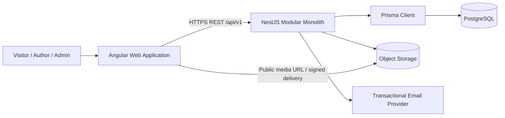

# Bachina Labs Academy — Project Architecture

> **Update note (13 October 2026):** This is the detailed technical **baseline** created before the additional MCP and subscription-entitlement decisions. Its original exclusions of MCP/subscriptions have been superseded **only to the extent specified in `PRODUCT_REQUIREMENTS.md`, `SYSTEM_ARCHITECTURE.md`, `MCP_ARCHITECTURE.md`, and `PROJECT_MEMORY.md`**. Do not implement the starter Prisma schema unmodified: extend/review it for entitlements and MCP grants before migrations. Pricing/online billing remains undecided.


**Version:** 1.0 (implementation design draft)  
**Prepared by:** Skyra Tech  
**Project:** Bachina Labs Academy — Version 1  
**Technology:** Angular · NestJS · PostgreSQL · Prisma · TypeScript  
**Status:** Proposed implementation design; validate open decisions before coding.

> **Source of scope:** Bachina Labs Academy *Project Proposal & Scope v1.0* is the primary functional boundary. This document expands the approved *Solution Architecture & Project Implementation Plan v1.0* into a developer-ready design. Detailed implementation selections marked **[Proposed]** are recommendations, not newly approved paid functionality. Contractual matters remain governed by the client agreement and quotation.

## 1. Product boundary and outcomes

A responsive, publicly accessible technical-article publishing platform with (a) public home, article lists/details, authors, categories, tags and database-backed search; (b) registration, login, password reset, user/author profile; (c) author drafting, editing, preview and **direct publishing without admin approval**; (d) protected basic administration; (e) authenticated basic comments; (f) basic views/summary analytics; (g) transactional account/security email; (h) article share links; and (i) basic SEO and responsive design.

**Roles:** anonymous Visitor, Registered Author (including reading/commenting), Administrator. No separate editorial reviewer role or publish-approval queue.

**Explicitly outside V1:** LMS/courses, monetization/payments/subscriptions, mobile app, AI, advanced analytics/community/notifications, dedicated search clusters, mandatory Redis, distributed microservices, substantial migration and complex provider integrations. Require a written change request for new scope.

## 2. Architectural decisions and principles

| Decision | V1 approach | Rationale / guardrail |
|---|---|---|
| Application topology | Angular frontend + **one NestJS backend** | Microservice-ready **modular monolith**, not deployed microservices |
| Persistence | PostgreSQL, Prisma Client + migrations | Relational integrity and typed queries |
| Interface | Versioned JSON REST under `/api/v1`, Swagger/OpenAPI | Stable, testable API contracts |
| NestJS layers | Controller → Application Service → Repository → Prisma → PostgreSQL | No Prisma in controllers; ownership checks in services |
| Modules | Explicit domain ownership and narrow exports | Avoid arbitrary cross-module table access |
| Media | Object storage via storage adapter; database holds metadata | No binary uploads in Postgres |
| Search | PostgreSQL-backed published-content search | Dedicated search engine is out of scope |
| UI | Angular feature-oriented routes and shared design primitives | Lazy loading, responsive, consistent visual language |
| Rendering/SEO | **[Proposed]** Angular SSR/prerender for public routes where operationally suitable | Meet SEO requirement; exact deployment approach to be confirmed |
| Email | **[Proposed]** provider adapter and durable send-status record | Essential transactional messages; no campaign engine |
| Operations | Git, configuration per environment, CI checks, migrations, staging | Repeatable safe releases |

**Engineering rules:** strict TypeScript; DTO validation and explicit response shaping; dependency injection; least-privilege; server-side role + ownership enforcement; small cohesive modules; no domain logic in components/controllers; no long blocking work in HTTP requests where avoidable.

## 3. System context and request paths



**Article read:** client requests published article by slug → article controller → service checks `PUBLISHED` visibility → repository loads author, category, tags and media metadata → DTO → SSR/browser presentation; view tracking operates via controlled lightweight event/counting path.

**Article write:** authenticated author → guarded REST request → DTO validation → service enforces article ownership/status/slug semantics → repository/Prisma transaction → response. Publish creates a public URL immediately; **no pending-review state**.

**Comment:** authenticated account → content validation → verify article published → create comment → owner can manage own; admin can remove.

## 4. Domain modules and responsibilities

| Module | Owns | Public operations / collaborators |
|---|---|---|
| Auth | signup, sign-in/out, session/token lifecycle, reset credentials | Users, Notifications |
| Users | account, status, role, profile | Auth, Authors, Admin |
| Authors | public author presentation and published-article listing | Users, Articles |
| Articles | article content, draft/publish, ownership, slug/metadata | Categories, Tags, Media |
| Categories | managed article classifications | Articles, Admin |
| Tags | reusable labels | Articles, Admin |
| Search | published article discovery/filters/pagination | Articles repository facade |
| Media | image metadata, upload validation, provider abstraction | Articles, Users |
| Comments | authenticated comments, self-management, admin removal | Articles, Users |
| Analytics | basic article views and aggregate summaries | Articles, Admin |
| Notifications | transactional messages/provider abstraction | Auth, Users |
| Admin | guarded orchestration for user/article/taxonomy/comment operations | Delegates to owner modules; does not bypass domain policies |

**Module boundary policy:** Each module controls its persistence access and writes. Other modules call exposed application services/read-model contracts; avoid importing another module's repository simply to query a table. `common` contains cross-cutting code only.

## 5. Backend repository layout

```text
bachina-labs-academy/
├── apps/
│   ├── web/                          # Angular
│   │   └── src/app/
│   │       ├── core/                 # config, auth/session client, HTTP interceptors
│   │       ├── shared/               # reusable UI, directives, pipes
│   │       ├── layouts/              # public, author, admin shells
│   │       └── features/
│   │           ├── public/           # home, articles, authors, taxonomy, search
│   │           ├── auth/
│   │           ├── author/           # dashboard, editor, content management
│   │           └── admin/
│   └── api/                          # NestJS
│       ├── src/
│       │   ├── main.ts
│       │   ├── app.module.ts
│       │   ├── config/
│       │   ├── database/             # PrismaService, migration/seed integration
│       │   ├── common/               # guards, filters, interceptors, pipes, decorators
│       │   └── modules/
│       │       ├── auth/
│       │       ├── users/
│       │       ├── authors/
│       │       ├── articles/
│       │       ├── categories/
│       │       ├── tags/
│       │       ├── search/
│       │       ├── media/
│       │       ├── comments/
│       │       ├── analytics/
│       │       ├── notifications/
│       │       └── admin/
│       ├── prisma/
│       │   ├── schema.prisma
│       │   ├── migrations/
│       │   └── seed.ts
│       └── test/
├── docs/
│   ├── PROJECT_ARCHITECTURE.md
│   ├── DATABASE_ARCHITECTURE.md
│   ├── PRODUCT_REQUIREMENTS.md
│   ├── DEVELOPMENT_RULES.md
│   ├── DESIGN_SYSTEM.md
│   ├── PROJECT_TASKS.md
│   └── PROJECT_MEMORY.md
└── .github/workflows/              # [Proposed] automation
```

**[Proposed]** A simple workspace repository groups app and API; not a requirement for Nx, Turborepo or any particular monorepo vendor. Example module internal structure: `controllers/`, `dto/`, `services/`, `repositories/`, `policies/`, `types/`, module declaration and tests. Keep interfaces close to domain.

## 6. Frontend architecture and brand implementation

- **Public:** home, article listing/detail, author pages, taxonomy pages, search; SEO metadata; social preview metadata; public pages optimized for fast initial load.
- **Author:** dashboard, own article list, editor, drafts, preview, publish; protected routes; never assume frontend controls enforce ownership.
- **Admin:** basic users, articles, categories, tags, comments and supported summary metrics.
- **Authentication:** sign-in/register/reset screens; central session state and HTTP handling; route guards as UX only.
- **UI system:** premium minimal SaaS / editorial treatment, Linear-inspired clarity with distinct Bachina Labs Academy identity. **Orange primary `#F97316`, deep orange `#C2410C`, charcoal `#20242B`, warm cream `#FFF7ED`**; light, dark and system themes. Teal is **not** a brand color; semantic status colors can be used as needed. These are **design-direction decisions from project discussion**, not specifications quoted from client documents; retain as pending design approval.
- **[Proposed]** CSS design tokens with semantic color variables; reusable button, field, dialog, card, navigation, table, empty-state, typography and status patterns; keyboard accessible components and visible focus.
- Typed reactive forms, lightweight local state, lazy feature routes, tracked lists, pagination, image optimization and accessible article editing. Agree rich-text/Markdown editor choice before implementation; sanitize rendered article HTML if any.

## 7. API architecture (candidate endpoint inventory)

All paths start with `/api/v1`. The endpoint names below are **[Proposed] API contracts**, not pre-approved endpoint strings. Swagger reflects implementation.

| Group | Methods and example paths | Access |
|---|---|---|
| Auth | `POST /auth/register`, `/auth/login`, `/auth/logout`, `/auth/forgot-password`, `/auth/reset-password`, `GET /auth/me` | mixed public/auth |
| Profiles | `GET/PATCH /users/me` | owner |
| Authors | `GET /authors/:slug`, `GET /authors/:slug/articles` | public |
| Articles | `GET /articles`, `GET /articles/:slug` | public, published only |
| Author articles | `GET/POST /author/articles`, `GET/PATCH/DELETE /author/articles/:id`, `POST /author/articles/:id/publish`, `GET /author/articles/:id/preview` | authenticated author + owner |
| Taxonomy | `GET /categories`, `GET /tags` | public |
| Search | `GET /search?q=&category=&tag=&author=&page=` | public |
| Media | `POST /media/uploads` or signed upload flow | authenticated; type/size checks |
| Comments | `GET /articles/:id/comments`, `POST /articles/:id/comments`, `PATCH/DELETE /comments/:id` | read public; write auth + owner |
| Metrics | `POST /articles/:id/view`, `GET /author/analytics/summary`, `GET /admin/analytics/summary` | scoped, abuse-limited |
| Admin | `/admin/users`, `/admin/articles`, `/admin/categories`, `/admin/tags`, `/admin/comments` | administrator |

**API conventions [Proposed]:** consistent `{data, meta}` shapes, standard error payload, query pagination limits, UTC ISO timestamps, ID/slug normalization, explicit filtering allowlists, input size limits, no password/token leakage, OpenAPI response models. Use idempotency/transaction discipline for operations where retries create duplication.

## 8. Auth, permission and content-state design

**[Proposed]** Use secure **HttpOnly** cookies for session/refresh handling where frontend and backend origin topology permits, with `Secure`, `SameSite` and CSRF controls appropriate to deployment. If using bearer tokens instead, establish storage/rotation/revocation rules before implementation. Do not commit to both mechanisms implicitly. Password hashes use a modern adaptive algorithm (Argon2id or a suitably configured bcrypt implementation); tokens for resets must be random, time-limited and stored hashed. On password reset, revoke relevant active sessions as defined by security policy.

| Action | Visitor | Author | Admin |
|---|---:|---:|---:|
| Read published content and public profiles | Yes | Yes | Yes |
| Register/log in | Yes | Yes | Yes |
| Create/edit/publish own article | No | Yes | Admin article management per agreed controls |
| View another author's draft | No | No | Authorized admin access if included in admin management |
| Add/manage own comment | No | Yes | Yes |
| Moderate any comment | No | No | Yes |
| Manage users/categories/tags | No | No | Yes |
| View platform metrics | No | Own permitted metrics | Yes |

**Article states [Proposed]:** `DRAFT`, `PUBLISHED`, `UNPUBLISHED` (only if hiding/unpublishing is approved). Article draft is private even when slug assigned. `publishedAt` set on first successful publish; editing published content follows agreed live-edit semantics. Do not add `PENDING_APPROVAL`.

## 9. Storage, search, analytics and email

**Media:** type/MIME validation against decoded content where feasible, limits, safe random storage keys, allowed public delivery policy, cleanup strategy for unused files. Provider not yet selected; charges excluded.

**Search:** DB-backed query over published articles; title and body search where supported; category/tag/author filters; stable sorting and pagination; indexes and query plan review. **[Proposed]** PostgreSQL `tsvector`/GIN or suitable text-search approach depending content format and Prisma migration constraints. Dedicated index service not in V1.

**Analytics:** low-cost views plus aggregate counts. **[Proposed]** maintain `article_stats.view_count` with rate-limited/de-duplicated basic view recording; avoid collecting IP/user behavioral histories by default. Exact definition of a counted view requires product decision.

**Email:** onboarding/account/reset transactional templates, configurable sender/provider adapter, rate limits and minimal delivery status/logging. **[Proposed]** no permanent token in email log, no marketing lists; handle send failures without unsafe credentials exposure.

**Sharing:** user-side outbound share URLs + copy link. No need for server-side sharing history or new tables.

## 10. Security, reliability and delivery

- Nest global validation pipe: whitelist permitted DTO fields, reject malformed types; guards check both role and resource ownership.
- Central error filter produces safe client messages; structured logs exclude credentials, tokens, sensitive content and unnecessary PII.
- HTTPS, restricted CORS, security headers, rate limiting for authentication, comments, views and uploads; output sanitization and CSP where appropriate.
- Use Prisma parameterization and migrations; prevent N+1 using selected/related fetches and pagination; enforce database constraints too.
- Environmental config: `DATABASE_URL`, session secrets, storage credentials, email credentials, public site URL and allowed origins; never source-control secrets.
- Local / staging / production environments. Version migrations; take DB backup before destructive releases; test recovery plan.
- CI **[Proposed]:** lint, typecheck, unit/integration tests, build, migration checks and dependency audit; staging UAT before production.
- Accessibility/responsive test at representative viewport sizes; verify article SEO tags, sitemap/robots, canonical URLs.

## 11. Testing and acceptance traceability

| Domain | Essential validation |
|---|---|
| Auth | registration, duplicate email, login/logout, reset expiration, brute-force protection |
| Authorization | author cannot mutate another user's content; admin routes protected |
| Publishing | draft private; own edit/preview; direct publish; public visibility; unique slug |
| Taxonomy | managed categories/tags reflect in article discovery |
| Search | results only published; filter combination; pagination |
| Comments | authenticated create; own edit/delete; admin moderation; prohibited draft commenting |
| Analytics | basic view counting and authorized aggregate summaries |
| Email | supported transactional triggers and provider failure handling |
| Media | file type/size rejection; safe references; acceptable delivery |
| Frontend | responsive light/dark/system theme, keyboard/focus, SEO meta |
| Release | migrations run, critical smoke tests pass, staging UAT, deployment documentation |

## 12. Future-ready without future scope

Future article/search/email module extraction is supported by module APIs and provider adapters, but **does not** require message brokers, Kubernetes, independent service databases, Redis or distributed transactions today. Future LMS, mobile, paid access and advanced notifications are separate designs and commercial change requests.

## 13. Decisions requiring confirmation before implementation

1. **Hosting topology:** Angular SSR/prerender vs client render with SEO strategy; domains, cloud and object storage vendor.
2. **Authentication mechanism:** server session/secure cookies vs access/refresh tokens; session expiry and logout behavior.
3. **Article content format:** Markdown / rich-text JSON / sanitized HTML; editorial editor library; media insertion.
4. **Article status semantics:** whether authors can unpublish or delete published work and what public URLs do afterward.
5. **Comments:** edit window, moderation behavior (soft delete vs delete), spam/rate limits.
6. **Analytics counting definition:** what constitutes a unique view; expected reporting window.
7. **Profile information:** required public fields and author slug rules.
8. **Email and storage vendors:** account ownership, sender domain and operational usage fees.
9. **Design approval:** exact tokens, typography, logo, navigation and preview mockups.

**Approval boundary:** Decisions above should be made within the agreed Version 1 functionality. If they create new workflows/costs, process a change request.

## 14. Source materials

- *Bachina Labs Academy — Project Proposal & Scope*, v1.0 (30 September 2026) — controlling functional scope.
- *Bachina Labs Academy — Solution Architecture & Project Implementation Plan*, v1.0 (30 September 2026) — reference technology/engineering architecture.
- *Skyra Tech — Commercial Quotation ST-BLA-001*, v1.0 (30 September 2026) — commercial boundary.
- *Skyra Tech — Software Development & Services Agreement*, v1.0 (30 September 2026) — contractual terms and order of precedence.
