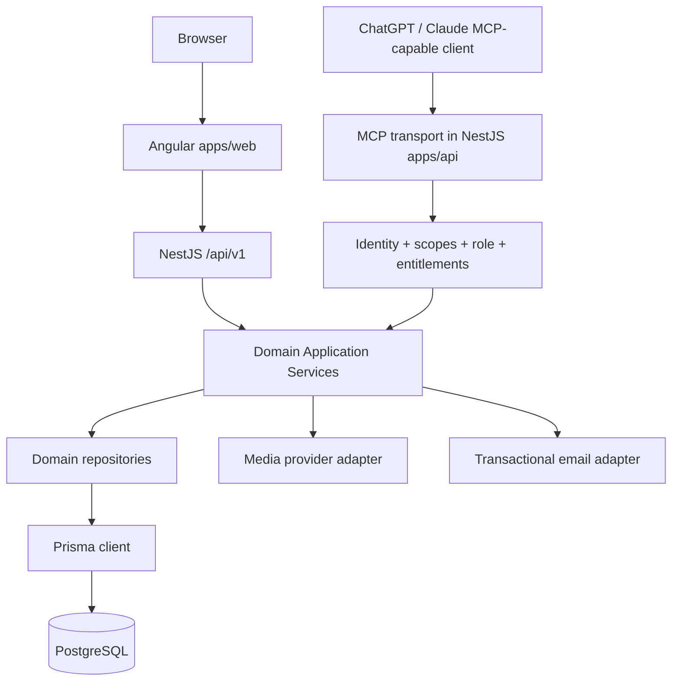

# Bachina Labs Academy — System Architecture

**Status:** Architecture baseline / implementation decisions where marked proposed. **Updated:** 2026-10-13

## 1. Repository and deployment topology
**One private Git repository, one product, two application projects, one PostgreSQL database.**

```text
BachinaLabsAcademy/
├── apps/
│   ├── web/              # One Angular application: public + author + admin
│   └── api/              # One NestJS application: REST + MCP
├── packages/             # Optional real shared contracts only
├── docs/                 # ALL project Markdown documentation (owned by Skyra Tech)
├── .github/workflows/     # CI as later approved
├── package.json
├── pnpm-workspace.yaml
├── pnpm-lock.yaml
├── .node-version
├── .gitignore
└── .editorconfig
```

Node installed by developer: **24.21.0**, npm **11.19.0**, pnpm **12.3.4**, Git **2.53.0.windows.2**. Angular 22 and NestJS 12 are **intended targets, verify compatibility at initialization**. Pin actual versions and package manager in repo. pnpm workspace scripts preferred; Nx/Turbo not necessary for two apps.



Angular may have SSR/prerendered public pages if justified; assess hosting and article SEO before turning on. REST and MCP are separate interfaces to **the same services**. One NestJS deployment initially; optional future extraction is not part of V1.

## 2. Backend domains and boundaries
- `auth`: registration, sign-in/out, resets, session/authorization token lifecycle, MCP authorization integration.
- `users` and `authors`: account data, public author profile projections, permissions.
- `articles`: content lifecycle, ownership, draft/edit/preview/explicit publish.
- `categories`, `tags`, `search`: taxonomy and published-content query endpoints.
- `media`: validated uploads, storage metadata and provider abstraction.
- `comments`: authenticated CRUD, moderation, ownership.
- `analytics`: article view count and basic summary queries; distinguish human views from MCP fetches.
- `notifications`: transactional emails and provider adapter.
- `subscriptions`: plans, assigned user subscriptions and lifecycle.
- `entitlements`: registered implemented features, plan mappings, effective checks and audit events.
- `mcp`: SDK transport, tool schemas/handlers, safe presenters and MCP authorization adapter.
- `admin`: protected orchestration of domain services; avoid direct cross-domain table writes.

In `apps/api/src`: keep `modules/`, `common/`, `config/`, and `database/`. Controller → application service → repository → Prisma → PostgreSQL. Thin controllers and MCP handlers. DTO validation, explicit responses, no business rules in Angular components. Cross-module access through exported services/interfaces; do not import other module's repositories arbitrarily.

## 3. Authentication and entitlement decision
Access to an operation is an intersection:

`accountActive && roleAllows(operation) && owns(resource) && featureEnabled && planEntitled && clientGrantAllows(operation)`

Apply only the relevant checks to each route/tool: public website article reads do not require login or a subscription; **MCP always requires authenticated entitlement**. MCP `tool/list` restrictions alone do not replace tool-level checks. Check effective subscriptions against current DB policy (or safely invalidatable short-lived cache) so expiry/revocation works mid-token. OAuth-compatible authorization for external assistants is **proposed**; validate practical compatibility before implementation. Never accept user IDs from MCP tools as authority to act as a user.

## 4. Feature configuration model
- Registered stable feature codes correspond to **implemented capabilities**, never arbitrary executable code.
- Plan-feature matrix is mutable by authorized admin; feature registry should be developer-controlled to avoid bogus features.
- Protected admin abilities and security infrastructure are never commercial entitlements.
- Enforce dependencies (for example MCP publishing requires MCP access and article publish permission), validate changes, audit admin updates.
- Do not hardcode plan names throughout backend or frontend. Admin can change paid-tier MCP allocation later; Free MCP must remain disabled per current business rule.

## 5. API and MCP contracts
- REST under `/api/v1`, OpenAPI/Swagger, typed DTOs, explicit pagination, validation and consistent errors.
- Candidate REST groups: `/auth`, `/users/me`, `/authors`, `/articles`, `/categories`, `/tags`, `/comments`, `/admin/*`, `/subscription-plans`, `/subscriptions/me`, `/entitlements/me` (review ownership and HTTP methods later).
- MCP uses isolated `/mcp` Streamable HTTP endpoint **proposed**. Tool contracts and safety rules in `MCP_ARCHITECTURE.md`. MCP integration must not call its own REST API or import repositories directly.

## 6. Angular organization
Single `apps/web` Angular application. `core/` (auth/API/entitlement/theme), `shared/` (reusable UI), `features/` (public, auth, author, admin, subscriptions), `layouts/`. Lazy-load protected areas, provide accessible route/feature states, use HTTP interceptor and typed forms. No separate Angular apps per subscription tier. Runtime theme preference: light/dark/system using shared design tokens. Brand: orange `#F97316`, deep orange `#C2410C`, charcoal `#20242B`, warm cream `#FFF7ED`, slate `#64748B`.

## 7. Runtime and operations
HTTPS; security headers; CORS/origin policies; rate limits on auth + MCP; upload restrictions; content sanitization; secrets via environment; structured logs (without tokens/content body); health endpoint, backups, migration discipline, minimal CI for build/lint/test. Separate web and API deployments even though same Git repository; single DB. Provider choice and infrastructure budget TBD.

## 8. Testing boundaries
- REST functional tests, article state/ownership and no approval queue.
- Subscription expiration/revocation and plan-change authorization tests.
- MCP read/write, permission/scope mismatch, private-data leakage, expired entitlement, confirmation to publish and abuse tests.
- Light/dark/system smoke checks, build/lint/unit integration/e2e as practical.

## 9. Documentation precedence
`PROJECT_ARCHITECTURE.md` is the earlier detailed design baseline and may contain original V1 exclusions now superseded by explicit later scope decisions; use the **newer** `PRODUCT_REQUIREMENTS.md`, this file and `PROJECT_MEMORY.md` for those changes. Do not treat code scaffolding as agreement to unresolved product decisions.
